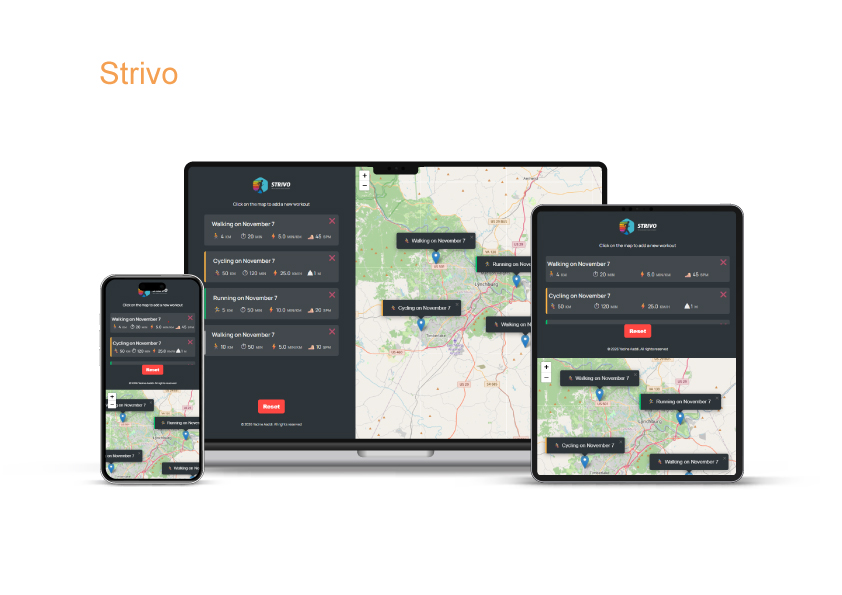

# Strivo

A tracking app that tracks workouts on an interactive map, recording key metrics like distance, duration, cadence, and elevation gain

## Links

https://strivo-inky.vercel.app

## Screenshots



## Features

- Create and manage running, walking, and cycling workouts
- Track distance, duration, pace, cadence, and elevation
- Dynamic workout forms with activity-specific fields
- Interactive map with workout location selection
- Persistent data using Local Storage
- Workout history and deletion
- Responsive user interface

## Javascript Patterns

- Geolocation API and Asynchronous Callbacks
- Array Methods (map, filter, find, forEach)
- Object-Oriented Programming (ES6 Classes)
- Class Inheritance and Method Overriding
- Encapsulation with Private Class Fields
- DOM Manipulation and Dynamic Rendering
- Event Delegation and Event Binding
- Data Serialization with JSON

## Technical Architecture

- Centralized workout state management
- Modular and reusable code structure
- Separation of UI and business logic
- Dynamic map markers and UI updates
- Local Storage data persistence

## Tech Stack

- Browser APIs: Geolocation API, Local Storage
- APIMapping: Leaflet.js, OpenStreetMap
- Markup & Styling: HTML5, CSS3
- Version Control: Git & GitHub
- Language: JavaScript (ES6+)

## Folder Structure

```

Strivo/
│ ├── assets/
│ └── favicon/
├── logo.png
├── index.html
├── script.js
├── style.css
├── LICENSE
└── README.md

```

## License

This project is licensed under the MIT License - see the [LICENSE](LICENSE) file for details.

## Contact

Software Engineering Graduate · Frontend / Full-Stack Developer

Yacine Aaddi - [yacineaaddi@gmail.com](mailto:yacineaaddi@gmail.com)
